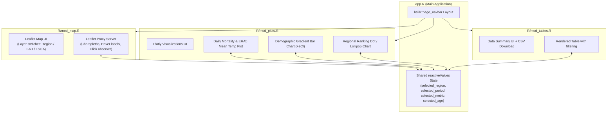

# Application Architecture: UK Heatwave 2026 Mortality Shiny Explorer (`UKHW2026-app`)

## 1. Executive Summary & Objectives ----

This document specifies the end-to-end data processing and software architecture for `UKHW2026-app`, a fast, modern R Shiny web application designed to communicate the public health impacts of the record-breaking 2026 heatwaves in England & Wales. 

Based on the small-area epidemiological model developed by the London School of Hygiene and Tropical Medicine (LSHTM), the study estimated:
- **5,827** total heat-related excess deaths (95% empirical confidence interval [eCI]: 4,349–6,897) across 1 May to 30 September 2026.
- **91.4%** of the burden (5,325 deaths) occurred within five distinct heatwave periods.
- **75.7%** of excess deaths (4,408 deaths) occurred among older adults aged 75 and older.
- Substantial geographical variation across 10 regions, 348 Local Authority Districts (LADs), and 34,753 Lower Layer Super Output Areas (LSOAs).

### Core Architectural Goals
1. **Sub-second Reactivity:** Heavy spatial geometries (34,753 LSOAs) and raw analysis outputs must be pre-processed, simplified, transformed into `EPSG:4326`, and stored as pre-joined, wide-pivoted `.rds` and columnar `.parquet` files. The Shiny server must never perform spatial joins or reprojections at runtime.
2. **Parsimonious & Modular Design:** Clean modular architecture (`app.R`, `R/mod_map.R`, `R/mod_plots.R`, `R/mod_tables.R`) communicating via a unified `reactiveValues` state object without unnecessary dependencies or speculative layers.
3. **Public Accessibility & Impact:** High-contrast, publication-grade visualizations using `bslib` (Bootstrap 5), `leaflet`, and `plotly` to serve researchers, journalists, policymakers, and the public.

---

## 2. Input Data Inventory & Discovered Schemas ----

Inspection of all input CSV outputs in `./data`, spatial GeoPackages, and ONS lookup files yielded the following verified structures:

### 2.1 Tabular Analysis CSV Outputs (`./data`)

| File Name | Dimensions | Geographic Granularity | Demographic Breakdown | Periods Available | Uncertainty (95% eCI) | Key Columns |
| :--- | :--- | :--- | :--- | :--- | :--- | :--- |
| `national_age_period.csv` | 30 × 10 | National (England & Wales) | 5 age groups | 6 periods | Yes (`lower`, `upper`, `ratelow`, `ratehigh`) | `agegr`, `period`, `age`, `population`, `estimate`, `lower`, `upper`, `rate`, `ratelow`, `ratehigh` |
| `region_age_period.csv` | 300 × 12 | 10 Regions | 5 age groups | 6 periods | Yes (`lower`, `upper`, `ratelow`, `ratehigh`) | `agegr`, `RGN11CD`, `period`, `age`, `region`, `population`, `estimate`, `lower`, `upper`, `rate`, `ratelow`, `ratehigh` |
| `national_75plus_period.csv` | 6 × 10 | National (England & Wales) | 75 and above (`age75plus`) | 6 periods | Yes (`lower`, `upper`, `ratelow`, `ratehigh`) | `agegr`, `period`, `age`, `population`, `estimate`, `lower`, `upper`, `rate`, `ratelow`, `ratehigh` |
| `region_75plus_period.csv` | 60 × 12 | 10 Regions | 75 and above (`age75plus`) | 6 periods | Yes (`lower`, `upper`, `ratelow`, `ratehigh`) | `agegr`, `RGN11CD`, `period`, `age`, `region`, `population`, `estimate`, `lower`, `upper`, `rate`, `ratelow`, `ratehigh` |
| `national_daily.csv` | 765 × 10 | National (England & Wales) | 5 age groups | 153 days (2026-05-01 to 2026-09-30) | Yes (`lower`, `upper`, `ratelow`, `ratehigh`) | `agegr`, `date`, `age`, `population`, `estimate`, `lower`, `upper`, `rate`, `ratelow`, `ratehigh` |
| `national_t2m_daily.csv` | 153 × 2 | National (England & Wales) | None (Environmental Exposure) | 153 days (2026-05-01 to 2026-09-30) | Point mean temperature | `date`, `meantemp` |
| `lsoa_hw_period.csv` | 173,765 × 14 | 34,753 LSOAs | All ages | 5 heatwave periods | Point estimates only (non-negative truncated) | `LSOA11CD`, `event`, `period`, `start_date`, `end_date`, `n_days`, `estimate`, `LSOA11NM`, `LAD11CD`, `LAD11NM`, `RGN11CD`, `RGN11NM`, `population`, `rate` |
| `lad_study_period.csv` | 348 × 12 | 348 LADs (E&W) | All ages | Full study period (`1 May-30 Sept`) | Point estimates only | `LAD11CD`, `LAD11NM`, `RGN11CD`, `RGN11NM`, `period`, `start_date`, `end_date`, `agegr`, `age`, `population`, `estimate`, `rate` |

### 2.2 Discovered Categorical Values
- **Periods (6 unique values):**
  1. `1 May-30 Sept` (Full season study period, 153 days)
  2. `HW1: 22 May-28 May` (7 days)
  3. `HW2: 18 Jun-28 Jun` (11 days)
  4. `HW3: 06 Jul-17 Jul` (12 days)
  5. `HW4: 29 Jul-05 Aug` (8 days)
  6. `HW5: 11 Aug-15 Aug` (5 days)
- **Age Categories:**
  - Standard groups (`age` / `agegr`): `0-64` (`age064`), `65-74` (`age6574`), `75-84` (`age7584`), `85 and above` (`age85plus`), `All ages` (`all`).
  - High-risk aggregated group: `75 and above` (`age75plus`).
- **Regions (10 official 2011 ONS administrative regions):**
  1. `E12000001` — North East
  2. `E12000002` — North West
  3. `E12000003` — Yorkshire and The Humber
  4. `E12000004` — East Midlands
  5. `E12000005` — West Midlands
  6. `E12000006` — East of England
  7. `E12000007` — London
  8. `E12000008` — South East
  9. `E12000009` — South West
  10. `W92000004` — Wales

---

## 3. Spatial Boundary Files & Lookup Resolution ----

### 3.1 Network Boundary Files
- **2011 LSOA Boundaries (England & Wales):**
  - **Path:** `//storageondemand/VOLQ/AGteam/ONS/geography/geopkg/LSOA_Dec_2011_Boundaries_Generalised_Clipped_BGC_EW_V3_-8900651938344784411.gpkg`
  - **Layer:** `LSOA_2011_EW_BGC_V3`
  - **Features:** 34,753 polygons (Native CRS: `EPSG:27700` British National Grid).
  - **Fields:** `LSOA11CD`, `LSOA11NM`, `LSOA11NMW`, `BNG_E`, `BNG_N`, `LONG`, `LAT`, `GlobalID`, `geom`.
- **2011 LAD Boundaries (Great Britain):**
  - **Path:** `//storageondemand/VOLQ/AGteam/ONS/geography/geopkg/Local_Authority_Districts_December_2011_GB_BGC_2022_6395663385981883839.gpkg`
  - **Layer:** `Local_Authority_Districts_December_2011_GB_BGC`
  - **Features:** 380 total (GB); filtered by `grepl("^[EW]", lad11cd)` to yield exactly 348 LADs in England & Wales (326 England + 22 Wales).
  - **Fields:** `lad11cd`, `lad11cdo`, `lad11nm`, `lad11nmw`, `GlobalID`, `geom`.

### 3.2 ONS 2011 LSOA-to-LAD-to-Region Lookup
- **Path:** `//storageondemand/VOLQ/AGteam/ONS/geography/lookup/Lower_Layer_Super_Output_Area__2011__to_Built-up_Area_Sub-division_to_Built-up_Area_to_Local_Authority_District_to_Region__December_2011__Lookup_in_England_and_Wales.csv`
- **Features:** 34,753 records linking `LSOA11CD` $\to$ `LAD11CD`/`LAD11NM` $\to$ `RGN11CD`/`RGN11NM`.

### 3.3 Region Boundary Synthesis
No standalone 2011 England & Wales Region GeoPackage exists on the storage drive (the only available shapefile is December 2019 England-only). Therefore, Region boundaries will be programmatically derived by dissolving the 348 England & Wales 2011 LAD polygons by `RGN11CD` / `RGN11NM` using `sf::st_union()` via the verified lookup table. This preserves topological consistency across LAD and Region tiers.

---

## 4. Data Granularity & Analytic Constraints ----

Careful attention to analytical constraints must be enforced in the UI and data displays:

```
+-----------------------------------------------------------------------------------------+
|                                    GEOGRAPHIC TIER                                      |
+------------------------------+---------------------------+------------------------------+
| National & Regional          | Local Authority (LAD)     | LSOA (Small Area)            |
+------------------------------+---------------------------+------------------------------+
| - 1 National + 10 Regions    | - 348 Local Authorities   | - 34,753 LSOAs               |
| - 5 Age Groups + 75+ + All   | - All ages only           | - All ages only              |
| - 6 Periods (Season + 5 HWs) | - Full Season only        | - 5 HWs + Total HW           |
| - 95% eCIs available         | - Point estimates only    | - Non-negative points only   |
| - Modelled rates per 1M      | - Rates per 1M pop        | - Rates per 1M pop           |
+------------------------------+---------------------------+------------------------------+
```

1. **LSOA Level (`lsoa_hw_period.csv`):**
   - Available only for `All ages`.
   - Broken down into the 5 individual heatwave events (`HW1` to `HW5`).
   - A 6th metric column, `Total_HW`, will be generated during pre-processing as the sum of non-negative estimates across the 5 heatwaves.
   - Per the methodology, negative LSOA point estimates are truncated to zero for spatial mapping. No empirical confidence intervals exist at the LSOA level.
2. **LAD Level (`lad_study_period.csv`):**
   - Available only for `All ages` and for the full study period (`1 May-30 Sept`).
   - Point estimates and rates only; no eCIs available (the underlying simulation draws were not stored at LAD level).
3. **Region & National Levels:**
   - Full demographic breakdown: `0-64`, `65-74`, `75-84`, `85 and above`, `All ages`, and combined `75 and above`.
   - Full empirical 95% confidence intervals (`lower`, `upper`, `ratelow`, `ratehigh`) derived from 500 Monte Carlo draws.
   - Available for all 6 periods.

---

## 5. Target Output Schemas (`app_data/`) ----

All preparation logic will reside in `data-prep/prep_app_data.R`. The outputs will be written to `app_data/` and checked into the app bundle or generated prior to deployment:

```
app_data/
├── national_daily.parquet         # Daily timeseries (excess deaths + t2m mean temp + eCIs)
├── national_period.parquet        # Combined national age groups + 75plus for all 6 periods
├── region_period.parquet          # Combined regional age groups + 75plus for 10 regions x 6 periods
├── lad_study_period.parquet       # 348 LADs tabular data
├── lsoa_hw_period.parquet         # 34,753 LSOAs tabular data (HW1..HW5 + Total)
├── geo_regions.rds                # sf object: 10 regions (EPSG:4326), pre-joined wide metrics
├── geo_lads.rds                   # sf object: 348 LADs (EPSG:4326), pre-joined study period metrics
└── geo_lsoas.rds                  # sf object: 34,753 LSOAs (EPSG:4326, simplified), pre-joined wide metrics
```

### 5.1 Parquet Tabular Schemas (Columnar Read via `arrow`)
- **`national_daily.parquet`**:
  - `date` (Date, 2026-05-01 to 2026-09-30)
  - `agegr` (chr: `age064`, `age6574`, `age7584`, `age85plus`, `all`)
  - `age` (chr: `0-64`, `65-74`, `75-84`, `85 and above`, `All ages`)
  - `population` (int)
  - `estimate`, `lower`, `upper` (dbl: excess death count + 95% eCI)
  - `rate`, `ratelow`, `ratehigh` (dbl: rate per million + 95% eCI)
  - `meantemp` (dbl: ERA5 national mean temperature in °C)
- **`region_period.parquet`**:
  - `RGN11CD` (chr, e.g. `E12000007`)
  - `region` (chr, e.g. `London`)
  - `period` (chr: 6 periods)
  - `agegr` (chr: `age064`, `age6574`, `age7584`, `age85plus`, `age75plus`, `all`)
  - `age` (chr: `0-64`, `65-74`, `75-84`, `85 and above`, `75 and above`, `All ages`)
  - `population`, `estimate`, `lower`, `upper`, `rate`, `ratelow`, `ratehigh`
- **`national_period.parquet`**:
  - Same schema as `region_period.parquet` without `RGN11CD` and `region`.

### 5.2 Spatial `.rds` Schemas (`sf` in `EPSG:4326`)
To maximize Leaflet rendering speed, spatial objects are pre-simplified with `rmapshaper::ms_simplify()` (preserving topology), transformed from British National Grid (`EPSG:27700`) to WGS 84 (`EPSG:4326`), and pre-joined in wide format:

- **`geo_regions.rds`** (10 features):
  - `RGN11CD`, `RGN11NM`
  - Wide columns for All Ages and 75+:
    - `est_study_period`, `rate_study_period`
    - `est_HW1` to `est_HW5`, `rate_HW1` to `rate_HW5`
  - `geometry` (MULTIPOLYGON in `EPSG:4326`)
- **`geo_lads.rds`** (348 features):
  - `LAD11CD`, `LAD11NM`, `RGN11CD`, `RGN11NM`, `population`
  - `estimate`, `rate` (full study period point estimates)
  - `geometry` (MULTIPOLYGON in `EPSG:4326`)
- **`geo_lsoas.rds`** (34,753 features, simplified keep ratio ~0.02–0.03):
  - `LSOA11CD`, `LSOA11NM`, `LAD11CD`, `RGN11CD`, `population`
  - `est_HW1` through `est_HW5`, `est_total`
  - `rate_HW1` through `rate_HW5`, `rate_total`
  - `geometry` (MULTIPOLYGON in `EPSG:4326`)

*Performance Advantage:* When switching from HW1 to HW2 in the map, the Leaflet proxy does not re-join or re-calculate polygons; it simply re-evaluates the existing column vector (e.g. `values = ~rate_HW2`) through `leaflet::colorNumeric()`, resulting in instantaneous UI updates.

---

## 6. Modular Shiny Application Architecture ----

The application will follow standard production R/Shiny modular design:



### 6.1 Directory Layout
```
UKHW2026-app/
├── app.R                       # Top-level Shiny UI and server orchestrator
├── R/
│   ├── mod_map.R               # Interactive choropleth map module
│   ├── mod_plots.R             # Time-series, temperature, and age/region plots
│   ├── mod_tables.R            # Summary tables and data export module
│   └── utils_helpers.R         # Color palettes, formatting, and helper functions
├── data-prep/
│   └── prep_app_data.R         # ETL pipeline: CSVs + GPKGs -> app_data/
├── data/                       # Raw analysis CSV outputs (read-only)
├── app_data/                   # High-performance Parquet & RDS files
├── www/
│   └── custom.css              # Custom styling (brand colors, clean tooltips)
├── ARCHITECTURE.md             # This document
└── manucore.md                 # Study abstract and manuscript core
```

### 6.2 Shared `reactiveValues` State
A centralized state object bridges modules so user interactions propagate instantaneously:
```r
# Shared reactive state in app.R ----
state <- reactiveValues(
  geo_level = "region",          # "region", "lad", "lsoa"
  period = "1 May-30 Sept",      # "1 May-30 Sept", "HW1: 22 May-28 May", ...
  metric = "rate",               # "estimate" (Deaths) or "rate" (Per Million)
  age = "All ages",              # "All ages", "75 and above", "85 and above", ...
  selected_region = "All"        # "All" or RGN11CD code
)
```

- When a user clicks a Region polygon in `mod_map`, `state$selected_region` updates.
- `mod_plots` immediately reacts by isolating that region's daily trajectory and age breakdown.
- `mod_tables` filters the visible table rows to that region.

---

## 7. Implementation Roadmap ----

1. **Phase 1: ETL Pipeline (`data-prep/prep_app_data.R`)**
   - Read 8 CSV files from `./data`.
   - Read and filter 2011 LAD GPKG to England & Wales; dissolve to 10 Regions via lookup table.
   - Read 2011 LSOA GPKG and simplify with `rmapshaper::ms_simplify()`.
   - Transform spatial objects to `EPSG:4326`.
   - Pivot metrics to wide format and save `geo_regions.rds`, `geo_lads.rds`, `geo_lsoas.rds`.
   - Write optimized tabular `.parquet` files.
2. **Phase 2: Core Map Module (`R/mod_map.R`)**
   - Build Leaflet choropleth engine with layer switching (Region / LAD / LSOA).
   - Implement custom continuous/quantile palettes, clear legends, and hover cards.
3. **Phase 3: Plots Module (`R/mod_plots.R`)**
   - Build dual-axis interactive Plotly chart combining daily excess deaths and ERA5 mean temperatures with shaded heatwave intervals.
   - Build age distribution and regional ranking plots with 95% empirical error bars.
4. **Phase 4: Tables Module (`R/mod_tables.R`)**
   - Build searchable summary tables with direct CSV download handlers.
5. **Phase 5: Main Application Assembly (`app.R`)**
   - Compose tabbed `bslib::page_navbar` interface with theme styling.
   - Wire `state` synchronization across all modules.
