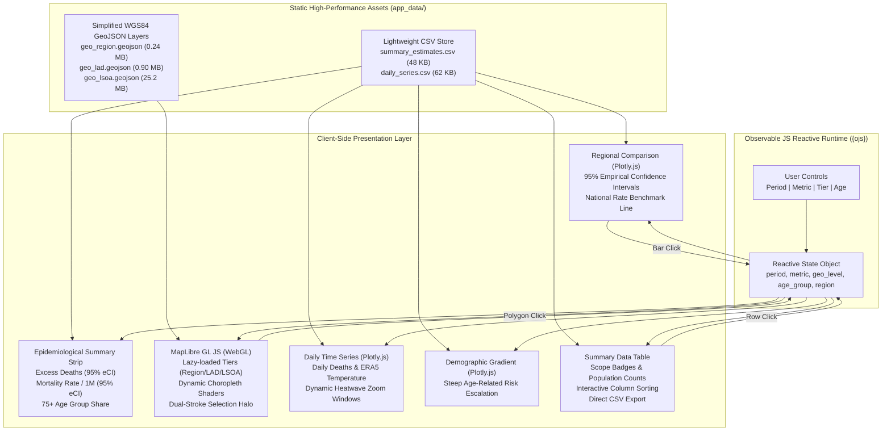

# UK Heatwave 2026: Excess Mortality Explorer (`UKHW2026-app`)

[](https://quarto.org/)
[](https://observablehq.com/)
[](https://maplibre.org/)
[](LICENSE)

An interactive, serverless **Quarto Dashboard** powered by **Observable JS ({ojs})** and **MapLibre GL JS**, designed to communicate the public health impacts of the record-breaking summer 2026 heatwaves across **England & Wales** (1 May to 30 September 2026).

Based on the small-area environmental epidemiology framework developed at the **London School of Hygiene & Tropical Medicine (LSHTM)**, linking ECMWF ERA5-Land reanalysis temperatures to age- and location-specific temperature–mortality risk functions across **34,753 Lower Layer Super Output Areas (LSOAs)**.

---

## Key Epidemiological Findings

- **5,827 Total Excess Deaths** (95% empirical confidence interval [eCI]: 4,349–6,897) across the extended warm season (equivalent to 97.6 deaths per million population).
- **Episodic Concentration (91.4%):** 5,325 excess deaths occurred within five discrete heatwave episodes, led by 18–28 June (1,808 deaths) and 6–17 July (1,468 deaths).
- **Disproportionate Impact on Older Adults (75.7%):** People aged 75 and older accounted for 4,408 deaths (3,367–5,334), despite representing only 8.7% of the total population.
- **Record Daily Peaks:** Single-day modelled mortality peaked on 26 June (409 deaths; 306–475) and 13 August (405 deaths; 276–479).
- **Pronounced Geographic Disparities:** Rates per million were highest in the West Midlands (133.9), South East (133.0), and London (132.4), and lowest in the North East (41.7).

---

## Application Architecture & Data Flow



---

## Running the Application

Because the application is built with static Quarto and client-side Observable JS, it runs entirely in the browser without requiring a backend R server process. Due to browser security restrictions on asynchronous asset loading (CORS), it must be served over HTTP rather than opened as a raw `file://` URL.

### 1. Live Preview with Quarto CLI

Using the Quarto CLI:

```bash
quarto preview index.qmd
```

This starts a local development server with hot-reloading and automatically opens the dashboard in your default browser.

### 2. Serving the Built `_site` Directory

The production-ready assets are compiled into the `_site/` directory. You can serve them using any static web server:

**Using Python:**
```bash
cd _site
python -m http.server 8080
```
Then navigate to `http://localhost:8080`.

**Using R (`servr`):**
```r
servr::httd("_site", port = 8080)
```

**Using Node.js:**
```bash
npx serve _site
```

### 3. (Optional) Recompiling Assets & Dashboard

To regenerate the web-ready CSV and GeoJSON static assets from the underlying Parquet/RDS files, then rebuild the site:

```bash
Rscript 00_prep_static_data.R
quarto render index.qmd
```

---

## Methodological Summary & Interpretation

> **Important Public Health Notice:** The figures presented in this dashboard are **modelled statistical estimates of heat-related excess mortality** associated with ERA5-Land/ERA5 reanalysis temperatures and historical baseline mortality, **not** registered death certificates.

- **Exposure Data:** Daily 2-m mean and maximum temperatures retrieved at LSOA centroids via the Open-Meteo Historical Weather API using ECMWF ERA5-Land (and ERA5 for coastal areas).
- **Mortality Models:** Age- and location-specific distributed lag non-linear models (DLNMs, lags 0–21 days) fitted to 2000–2019 data.
- **Denominators:** 2020 LSOA mid-year populations and 2024 regional baseline mortality rates.
- **Uncertainty:** 95% empirical confidence intervals (eCIs) derived from 500 Monte Carlo draws of the model coefficients.

---

## License

This project is licensed under the [MIT License](LICENSE).
