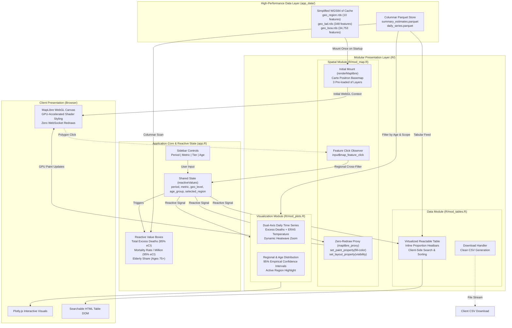

# UK Heatwave 2026: Excess Mortality Explorer (`UKHW2026-app`)

[](https://www.r-project.org/)
[](https://shiny.posit.co/)
[](https://walker-data.com/mapgl/)
[](LICENSE)

An interactive, fast, and modern **R Shiny web application** built to communicate the public health impacts of the record-breaking summer 2026 heatwaves across **England & Wales** (1 May to 30 September 2026).

Based on the small-area environmental epidemiology framework developed at the **London School of Hygiene & Tropical Medicine (LSHTM)**, linking ECMWF ERA5-Land reanalysis temperatures to age- and location-specific temperature–mortality risk functions across **34,753 Lower Layer Super Output Areas (LSOAs)**.

---

## Key Epidemiological Findings

- **5,827 Total Excess Deaths** (95% empirical confidence interval [eCI]: 4,349–6,897) across the extended warm season (equivalent to 97.6 deaths per million population).
- **Episodic Concentration (91.4%):** 5,325 excess deaths occurred within five discrete heatwave episodes, led by 18–28 June (1,808 deaths) and 6–17 July (1,468 deaths).
- **Concentration in Older Adults (75.7%):** People aged 75 and older accounted for 4,408 deaths (3,367–5,334), despite representing only 8.7% of the total population.
- **Record Daily Peaks:** Single-day modelled mortality peaked on 26 June (409 deaths; 306–475) and 13 August (405 deaths; 276–479).
- **Pronounced Geographic Disparities:** Rates per million were highest in the West Midlands (133.9), South East (133.0), and London (132.4), and lowest in the North East (41.7).

---

## Application Architecture & Data Flow



### Directory Structure

```
UKHW2026-app/
├── app.R                  # Main Shiny application entry point & reactive state orchestrator
├── 00_prep_app_data.R     # Data preparation pipeline (ETL: CSVs + GPKGs -> app_data/)
├── R/
│   ├── mod_map.R          # WebGL choropleth map module (mapgl / MapLibre GL JS)
│   ├── mod_plots.R        # Synchronized Plotly visualizations (Figure 1 time series & rankings)
│   ├── mod_tables.R       # Filterable data summary table and CSV export (reactable)
│   └── utils_ui.R         # UI utilities, formatting functions, and About/Methods modal
├── app_data/              # High-performance Parquet tables & simplified WGS84 spatial RDS files
│   ├── summary_estimates.parquet   # Combined national & regional estimates (396 rows)
│   ├── daily_series.parquet        # Merged daily excess deaths & ERA5 temperatures (765 rows)
│   ├── geo_region.rds              # 10 dissolved Region boundaries (WGS84, 0.14 MB)
│   ├── geo_lad.rds                 # 348 Local Authority District boundaries (WGS84, 0.45 MB)
│   └── geo_lsoa.rds                # 34,753 LSOA boundaries (simplified WGS84, 6.55 MB)
├── data/                  # Original analysis CSV output files
└── www/
    └── styles.css         # Bespoke data-journalism theme stylesheet
```

### Core Technical Highlights
1. **Zero-Redraw WebGL Mapping (`mapgl`):** Uses MapLibre GL JS to render 34,753 LSOAs, 348 LADs, and 10 Regions. Changing periods, metrics, or geographic tiers updates GPU shader expressions (`set_paint_property`) and visibility (`set_layout_property`) instantaneously without redrawing polygons or reloading GeoJSON over the WebSocket.
2. **Synchronized Plotly Visualizations:**
   - **Figure 1 Time Series:** Dual-axis chart linking daily national excess deaths to ERA5 mean temperatures with shaded bands for the 5 heatwave periods and reactive zoom windows.
   - **Regional Rankings:** Horizontal interval plots with 95% empirical confidence intervals and reactive cross-highlighting from map clicks.
   - **Demographic Gradient:** Visualizes the steep exponential risk gradient across age groups (`0–64`, `65–74`, `75–84`, `85+`).
3. **Responsive Client-Side Table (`reactable`):** Fast multi-column sorting, text search, proportional inline heat bars, and direct CSV data export.
4. **Columnar Parquet & Pre-Simplified Spatial Cache:** Tabular datasets load in sub-millisecond times via `arrow::read_parquet()`, while spatial layers are pre-joined in wide format and simplified with `rmapshaper::ms_simplify()` in `EPSG:4326`.

---

## Quickstart: Running the Application

### 1. Prerequisites
Ensure R (>= 4.3.0) is installed. Install the required CRAN packages:

```r
install.packages(c(
  "shiny",
  "bslib",
  "arrow",
  "data.table",
  "sf",
  "mapgl",
  "plotly",
  "reactable",
  "htmltools",
  "rmapshaper",
  "dplyr"
))
```

### 2. Launching the App
In R or RStudio, run:

```r
shiny::runApp()
```

The application will launch on your local browser.

### 3. (Optional) Regenerating `app_data/`
The repository already includes the pre-processed assets in `app_data/`. To re-run the ETL pipeline from the raw CSVs and ONS boundary files:

```r
source("00_prep_app_data.R")
```

---

## Methodological Summary & Interpretation

> **Important Public Health Notice:** The figures presented in this dashboard are **modelled statistical estimates of heat-related excess mortality** associated with ERA5-Land/ERA5 reanalysis temperatures and historical baseline mortality, **not** registered death certificates.

- **Exposure Data:** Daily 2-m mean and maximum temperatures retrieved at LSOA centroids via the Open-Meteo Historical Weather API using ECMWF ERA5-Land (and ERA5 for coastal areas).
- **Mortality Models:** Age- and location-specific distributed lag non-linear models (DLNMs, lags 0–21 days) fitted to 2000–2019 data.
- **Denominators:** 2020 LSOA mid-year populations and 2024 regional baseline mortality rates.
- **Uncertainty:** 95% empirical confidence intervals (eCIs) derived from 500 Monte Carlo draws of the model coefficients.

---

## License

This project is licensed under the [MIT License](LICENSE).
